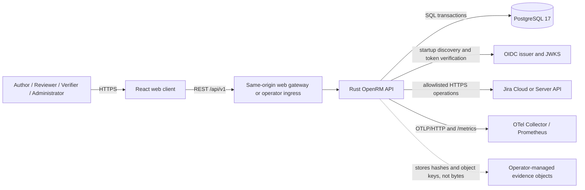
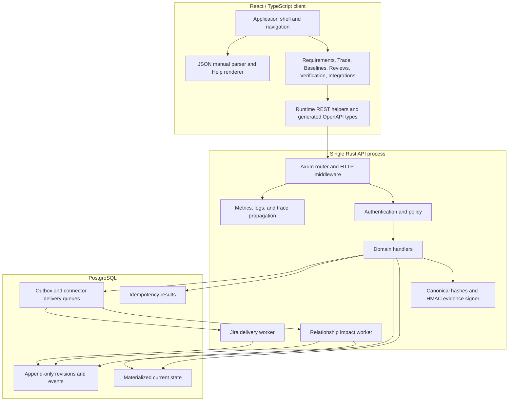
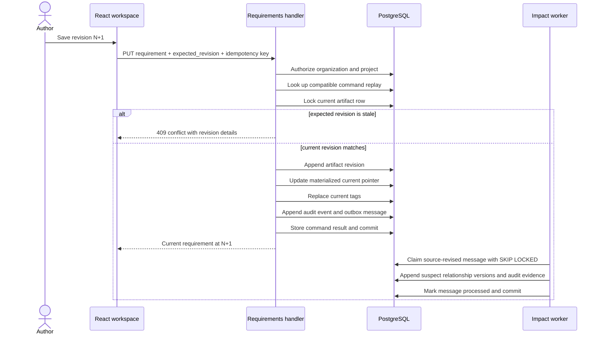
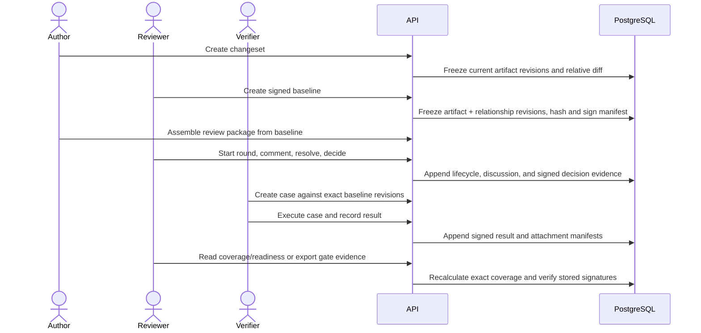
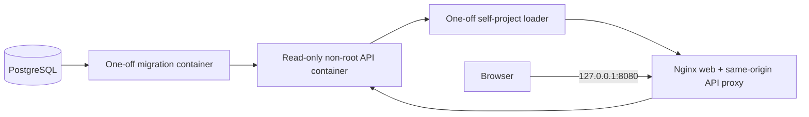
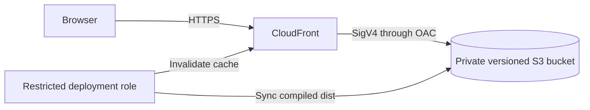

# OpenRM Software Design Description

| Field | Value |
| --- | --- |
| Document ID | `OPENRM-SDD-001` |
| Version | 1.0 |
| Status | Maintained baseline |
| Applies to | OpenRM `0.1.0`; repository baseline `d69cfca` and later changes that preserve this document |
| Last verified | 8 November 2026 |
| Owner | OpenRM maintainers |
| Primary audience | Developers, reviewers, security engineers, operators, and release maintainers |
| Authoritative location | `docs/design/SOFTWARE_DESIGN_DESCRIPTION.md` |

This Software Design Description (SDD) is the maintainer-oriented design reference for OpenRM. It explains the implemented system, the static AWS preview, the operator-owned production boundary, and the source paths that must change together. The source code, OpenAPI contract, migrations, and accepted architecture decision records (ADRs) remain normative if this document and executable behavior disagree.

## Table of contents

1. [Purpose and scope](#1-purpose-and-scope)
2. [System status and design boundaries](#2-system-status-and-design-boundaries)
3. [Architectural drivers](#3-architectural-drivers)
4. [System context](#4-system-context)
5. [Logical architecture](#5-logical-architecture)
6. [Component design](#6-component-design)
7. [Runtime interactions](#7-runtime-interactions)
8. [API and interface design](#8-api-and-interface-design)
9. [Data, revision, and evidence design](#9-data-revision-and-evidence-design)
10. [Identity, authorization, and tenancy](#10-identity-authorization-and-tenancy)
11. [Asynchronous processing and connectors](#11-asynchronous-processing-and-connectors)
12. [Web client and in-product Help](#12-web-client-and-in-product-help)
13. [Configuration and secrets](#13-configuration-and-secrets)
14. [Deployment topologies](#14-deployment-topologies)
15. [Security design](#15-security-design)
16. [Observability and service objectives](#16-observability-and-service-objectives)
17. [Failure handling, backup, recovery, and upgrades](#17-failure-handling-backup-recovery-and-upgrades)
18. [Verification and delivery controls](#18-verification-and-delivery-controls)
19. [Maintenance guide](#19-maintenance-guide)
20. [Known limitations and open design work](#20-known-limitations-and-open-design-work)
21. [ADR traceability](#21-adr-traceability)
22. [Source traceability and document maintenance](#22-source-traceability-and-document-maintenance)
23. [Glossary](#23-glossary)

## 1. Purpose and scope

OpenRM is an open, self-hostable configuration and requirements management platform. Its implemented pilot scope supports:

- organization- and project-scoped access;
- controlled requirement authoring and immutable revision history;
- directed traceability, impact detection, and suspect-link resolution;
- attributable changesets and immutable signed baselines;
- baseline-bound reviews, signed decisions, and segregation of duties;
- independent verification cases, runs, signed results, attachment manifests, coverage, and gate readiness;
- a governed Jira delivery queue with retry, dead-letter, and replay evidence;
- operational metrics, traces, backup/recovery procedures, and a portable container distribution; and
- a structured JSON user manual rendered as in-product Help.

This SDD covers the React/TypeScript client, Rust API and in-process workers, PostgreSQL schema, versioned REST contract, deployment assets, AWS static preview, operational controls, and maintenance workflow. It does not claim that a customer production environment has been commissioned. Environment-specific identity, network, secret, database continuity, alert routing, and external assurance remain operator acceptance responsibilities.

### 1.1 Normative sources

When resolving ambiguity, use the following precedence:

1. executable behavior and tests;
2. the [OpenAPI contract](../../contracts/openapi.yaml) and [database migrations](../../db/migrations/);
3. accepted [ADRs](../adr/README.md);
4. security and operations procedures under [`docs/security`](../security/) and [`docs/operations`](../operations/);
5. this SDD; and
6. illustrative dashboard copy.

Dashboard mock data and architecture cards are explanatory product surfaces, not a substitute for the contract or implementation.

## 2. System status and design boundaries

OpenRM has three deliberately separate operating boundaries.

| Boundary | Implemented purpose | Contains controlled data? | Current status |
| --- | --- | ---: | --- |
| Portable development stack | Complete local product: PostgreSQL, migrations, API, self-verification bootstrap, and same-origin web gateway | Yes, development data | Implemented and CI verified |
| Hardened pilot topology | PostgreSQL, API, OpenTelemetry Collector, Prometheus, and Grafana definition | Yes, when commissioned | Repository artifact verified; environment not commissioned |
| AWS static preview | Compiled React assets behind CloudFront and a private S3 origin | No | Deployed preview; no API or database |

The AWS preview is not the production topology. It intentionally contains no API, PostgreSQL database, OIDC provider, evidence store, or Jira secret. When its browser cannot reach an API, the Requirements workspace displays explicit sample data and other live workspaces display offline state.

### 2.1 Design classifications

- **Implemented:** behavior present in code and protected by automated evidence.
- **Configured:** an artifact exists in the repository, but an operator must supply an environment and secrets.
- **Preview-only:** illustrative behavior that must not receive production data.
- **Planned:** accepted direction without a complete runtime path; planned behavior is called out rather than described as current capability.

## 3. Architectural drivers

The main design drivers are:

1. **Controlled history.** Requirements, relationships, baselines, review evidence, and verification evidence must retain exact, attributable history.
2. **Tenant isolation.** Organization is the hard tenant boundary; projects add a narrower authorization scope.
3. **Deterministic evidence.** Baselines and gate exports must be reproducible, hashable, signed, and independently verifiable.
4. **Safe retry.** Mutating commands and external deliveries must be idempotent or detect incompatible replay.
5. **Portable operation.** The core must run with PostgreSQL and containers without a mandatory proprietary platform service.
6. **Small initial operating model.** The MVP uses one deployable API with internal domain modules and in-process workers; service extraction requires measured need.
7. **Observable failure.** Queue age, dead letters, errors, latency, readiness, and recovery evidence must be visible to operators.
8. **Secure defaults.** Production rejects development authentication, credentials stay outside persisted connector configuration, and application containers run without root or Linux capabilities.

## 4. System context



### 4.1 External actors and systems

| Actor or system | Responsibility | Trust boundary |
| --- | --- | --- |
| Author | Creates and revises requirements, relationships, changesets, and review packages within project policy | Browser/API authentication and project authorization |
| Reviewer | Reviews exact baseline content, resolves suspect links, records signed decisions | Review membership and segregation-of-duty checks |
| Verifier | Executes assigned verification cases and records signed results | Exact baseline target and independent-owner checks |
| Administrator | Creates projects, manages membership, connectors, and operations status | Organization role plus project scope |
| OIDC provider | Authenticates production subjects and signs access tokens | HTTPS discovery/JWKS, issuer, audience, expiry, and algorithm validation |
| PostgreSQL | Canonical product state, immutable histories, audit, and queues | Authenticated private connection; tenant predicates and composite keys |
| Jira | Receives governed outbound updates | HTTPS fixed paths, external token, bounded retry |
| Observability stack | Receives metrics and optional traces | Operator-controlled monitoring boundary |
| Evidence object store | Retains attachment bytes addressed by recorded key and SHA-256 | External to the current API; operator owns upload, retention, and access |

## 5. Logical architecture



The API is a modular monolith. Domain modules share one `AppState`, one PostgreSQL pool, one policy engine, and one evidence signer. This preserves atomic cross-domain transactions and keeps deployment small. A future service split must preserve the exact revision, idempotency, audit, and evidence contracts before it is accepted.

## 6. Component design

### 6.1 Web components

| Component | Responsibility | Primary source |
| --- | --- | --- |
| Application shell | Navigation, page selection, preview surfaces, delivery dashboard, guided tour | [`src/main.tsx`](../../src/main.tsx) |
| Requirements workspace | Live authoring, organization resources, search, compare, import/export; explicit static fallback | [`src/requirements/RequirementsWorkspace.tsx`](../../src/requirements/RequirementsWorkspace.tsx) |
| Traceability workspace | Graph/matrix/coverage reads and suspect-link disposition | [`src/traceability/TraceabilityWorkspace.tsx`](../../src/traceability/TraceabilityWorkspace.tsx) |
| Baselines workspace | Changeset/baseline creation, comparison, signed export | [`src/baselines/BaselinesWorkspace.tsx`](../../src/baselines/BaselinesWorkspace.tsx) |
| Review workspace | Package assembly, participants, rounds, comments, resolutions, and decisions | [`src/reviews/ReviewsWorkspace.tsx`](../../src/reviews/ReviewsWorkspace.tsx) |
| Verification workspace | Cases, runs, results, coverage, readiness, due events, and export | [`src/verification/VerificationWorkspace.tsx`](../../src/verification/VerificationWorkspace.tsx) |
| Integration workspace | Jira configuration, delivery queue, health, and replay | [`src/integrations/IntegrationWorkspace.tsx`](../../src/integrations/IntegrationWorkspace.tsx) |
| Help workspace | Parses and renders the structured manual with search and stable anchors | [`src/help/HelpWorkspace.tsx`](../../src/help/HelpWorkspace.tsx), [`src/help/manual.ts`](../../src/help/manual.ts) |
| API support | Base URL, headers, runtime defaults, downloads, and generated types | [`src/api`](../../src/api/) |

### 6.2 Service components

| Module | Responsibility | Primary source |
| --- | --- | --- |
| Process bootstrap | Configuration, database connection, optional migration, auth discovery, workers, tracing, graceful shutdown | [`apps/api/src/main.rs`](../../apps/api/src/main.rs) |
| HTTP composition | Router, middleware, liveness/readiness, body and timeout limits, CORS, security headers | [`apps/api/src/lib.rs`](../../apps/api/src/lib.rs) |
| Configuration | Environment parsing and production invariants | [`apps/api/src/config.rs`](../../apps/api/src/config.rs) |
| Authentication | Development tokens and production OIDC discovery/JWT verification | [`apps/api/src/auth.rs`](../../apps/api/src/auth.rs) |
| Policy | Deny-by-default role/action matrix and organization boundary | [`apps/api/src/policy.rs`](../../apps/api/src/policy.rs) |
| Projects | Project creation, project membership, workspace resources, project authorization, audit helper | [`apps/api/src/projects.rs`](../../apps/api/src/projects.rs) |
| Requirements | Current records, immutable revisions, search, compare, import/export, optimistic concurrency | [`apps/api/src/requirements.rs`](../../apps/api/src/requirements.rs) |
| Relationships | Typed directed links, cardinality, exact endpoints, history, reviewer resolution | [`apps/api/src/relationships.rs`](../../apps/api/src/relationships.rs) |
| Controlled change | Trace views, changesets, baselines, comparison, deterministic evidence export | [`apps/api/src/controlled_change.rs`](../../apps/api/src/controlled_change.rs) |
| Reviews | Baseline-bound lifecycle, participants, comments, blockers, signed decisions | [`apps/api/src/reviews.rs`](../../apps/api/src/reviews.rs) |
| Verification | Exact targets, independent execution, signed results, coverage, readiness, due events, gate export | [`apps/api/src/verification.rs`](../../apps/api/src/verification.rs) |
| Evidence signing | HMAC-SHA256 signing and key-ID-aware verification | [`apps/api/src/evidence.rs`](../../apps/api/src/evidence.rs) |
| Relationship outbox | Asynchronous source-revision impact and suspect propagation | [`apps/api/src/outbox.rs`](../../apps/api/src/outbox.rs) |
| Jira connector | Configuration, queue, worker, retry classification, dead letters, replay | [`apps/api/src/connectors.rs`](../../apps/api/src/connectors.rs) |
| Observability | In-memory HTTP metrics, database/queue status, W3C context propagation, Prometheus output | [`apps/api/src/observability.rs`](../../apps/api/src/observability.rs) |
| Error model | Stable JSON error envelope and status mapping | [`apps/api/src/error.rs`](../../apps/api/src/error.rs) |

### 6.3 Persistence components

PostgreSQL is the canonical data store. Migrations are forward-only and embedded into the migration binary through SQLx. The migration set lives under [`db/migrations`](../../db/migrations/) and the dedicated entry point is [`apps/api/src/bin/migrate.rs`](../../apps/api/src/bin/migrate.rs).

## 7. Runtime interactions

### 7.1 Controlled requirement revision



The artifact revision, current pointer, tag state, audit event, outbox message, and command replay result commit as one transaction. Impact propagation is intentionally eventual but records the exact revised source revision.

### 7.2 Baseline, review, and verification chain



An approval is valid only for the active review round and immutable baseline. The package creator and baseline creator cannot approve their own package. Verification execution is limited to the assigned owner, who must be a review participant and independent of those creators.

### 7.3 Jira delivery

1. An administrator creates or revises a Jira configuration using optimistic `expected_version` control. Only the reference `env:JIRA_API_TOKEN` is persisted.
2. An authorized command enqueues one delivery using a stable event key and payload hash.
3. The connector worker claims eligible work using `FOR UPDATE SKIP LOCKED`, increments its attempt, and releases the transaction before network I/O.
4. Dry-run mode succeeds without a remote call. Active mode sends to one of three fixed Jira REST paths.
5. Successful responses mark delivery complete. HTTP 408, 425, 429, 5xx, and transport failures retry while attempts remain; `Retry-After` is honored when valid, otherwise exponential backoff is capped at 300 seconds.
6. Terminal work enters `dead_letter`. Operator replay returns the same logical delivery to the queue and appends audit evidence; it does not invent a new event identity.

## 8. API and interface design

### 8.1 Contract

The [OpenAPI 3.1 contract](../../contracts/openapi.yaml) is the public HTTP source of truth. It currently defines 56 operations. Product routes are versioned under `/api/v1`; `/health`, `/ready`, and `/metrics` are operational routes outside the product namespace. TypeScript definitions are generated into [`src/api/generated.ts`](../../src/api/generated.ts) with `npm run generate:api` and must remain diff-clean under `npm run check:generated`.

Endpoint groups are:

- identity and session;
- projects, membership, and workspace configuration;
- requirements, revisions, compare, import, and export;
- relationship rules, relationships, history, and resolution;
- trace summary, matrix, and graph;
- changesets, baselines, comparison, and evidence;
- review packages, participants, lifecycle, comments, resolutions, decisions, and evidence;
- verification cases, runs, results, coverage, readiness, and due events;
- Jira configuration, deliveries, and replay; and
- health, readiness, metrics, and administrator operations status.

### 8.2 Request controls

| Control | Design |
| --- | --- |
| Authentication | `Authorization: Bearer <token>` on product routes |
| Tenant selection | `X-OpenRM-Organization: <uuid>`; the token must authorize the organization |
| Idempotency | `X-Idempotency-Key` for controlled commands; key, actor, organization, command, and request fingerprint identify compatible replay |
| Concurrency | Request-body `expected_revision` or `expected_version`; stale writes return `409` |
| Body size | Maximum 1 MiB at the router |
| Request duration | 30-second HTTP timeout |
| CORS | Development origin `http://127.0.0.1:5173`; deployed web is expected to use same-origin proxying |
| Methods | GET, POST, and PUT only in the current contract |

The implemented concurrency contract is body-based optimistic versioning. Any illustrative dashboard text referring to ETag/`If-Match` is not the current API contract.

### 8.3 Responses and errors

Controlled creates return `201`; replay of a stored command generally returns `200`. Validation uses `400`, missing authentication `401`, policy denial `403`, missing scoped resources `404`, stale or incompatible state `409`, dependency failure `503`, and uncaught service failure `500`.

Errors use:

```json
{
  "error": {
    "code": "conflict",
    "message": "Human-readable explanation",
    "request_id": "uuid",
    "details": {}
  }
}
```

Clients should branch on HTTP status and stable `error.code`, display `message`, and preserve identifiers for support. A current limitation is that the error-body `request_id` is generated independently of the `X-Request-ID` middleware header; maintainers must not promise one-to-one correlation until those values are unified.

### 8.4 Compatibility rules

- Additive response fields are backward compatible; clients must ignore unknown fields.
- Removing or renaming a field, changing enum meaning, changing canonical evidence ordering, or altering signature inputs requires explicit compatibility planning and normally a new API or evidence schema version.
- Contract changes require regenerated TypeScript, handler/test changes, user-manual review, and SDD review in the same pull request.

## 9. Data, revision, and evidence design

### 9.1 Data model overview

The nine migrations define 41 tables. They are grouped below by responsibility.

| Group | Current/materialized tables | Immutable or append-only evidence |
| --- | --- | --- |
| Identity and scope | `organizations`, `user_identities`, `organization_memberships`, `projects`, `project_memberships` | membership changes also emit `audit_events` through supported APIs |
| Requirement workspace | `artifact_types`, `artifacts`, `folders`, `tags`, `artifact_tags`, `custom_attribute_definitions`, `saved_views` | `artifact_revisions`, `audit_events`, `command_results` |
| Traceability | `relationship_types`, `relationships` | `relationship_revisions`, outbox-driven audit evidence |
| Controlled change | — | `changesets`, `changeset_entries`, `baselines`, `baseline_artifacts`, `baseline_relationships` |
| Reviews | `review_packages` | `review_package_events`, `review_participants`, `review_comments`, `review_comment_resolutions`, `review_decisions` |
| Verification | `verification_runs` carries current execution status | `verification_cases`, targets, run events, results, attachment manifests, due events |
| Integration and work queues | `connector_configurations`, `connector_deliveries`, `outbox_messages` | configuration events and delivery attempts |

### 9.2 Tenant integrity

Every controlled project row carries `organization_id` and `project_id`. Composite foreign keys include these identifiers so a valid row ID from one project or organization cannot be attached to another. Application queries supply the principal organization and project explicitly. PostgreSQL constraints are the final referential boundary; row-level security is not currently used.

### 9.3 Current state plus immutable history

`artifacts` and `relationships` are fast current-state projections. Each points to an exact row in its immutable history table with a deferrable foreign key, allowing the new revision and current pointer to commit atomically. Review packages and verification runs also carry materialized lifecycle state while append-only event/result tables preserve the evidence used to reconstruct decisions.

The database function `prevent_controlled_history_change()` rejects `UPDATE` and `DELETE` on controlled history tables. New evidence is appended; corrections create a later revision, event, or superseding baseline. Normal application workflows do not rewrite history.

ADR 0002 states that deletion should use a tombstone revision. The present public contract exposes no requirement-deletion operation, so tombstone behavior is an accepted design direction rather than an implemented API.

### 9.4 Idempotency and optimistic concurrency

`command_results` stores the organization, actor, command name, idempotency key, request fingerprint, aggregate identity, response revision, and response payload. A repeated compatible command returns its recorded result. Reuse of a key with a different fingerprint is rejected.

Mutable aggregates are locked before comparing the caller's expected revision/version. This prevents lost updates even when concurrent requests pass initial validation at the same time.

### 9.5 Deterministic manifests and signatures

Changesets snapshot current artifact revisions and classify entries relative to an optional parent. Baselines snapshot exact artifact and relationship revisions, relevant policy version, optional changeset, and optional superseded baseline. Manifests are serialized in deterministic order and SHA-256 hashed. Baselines, review decisions, verification results, and complete gate exports are signed using HMAC-SHA256 with a stored `signing_key_id`.

The active key signs new evidence. Historical verification keys let the service verify evidence created before an intentional rotation. Unknown key IDs and hash mismatches fail closed. HMAC is the current implementation; installations needing asymmetric or managed-key signing must introduce a versioned signing adapter without changing historical verification semantics.

### 9.6 Attachments and object storage

OpenRM currently stores attachment manifests only: object key, file name, media type, byte count, and SHA-256. It does not upload, download, virus-scan, authorize, or independently re-hash attachment bytes. The object system shown in product architecture views is an integration boundary, not a completed storage service. Operators must protect object bytes and maintain consistency with the recorded hashes.

### 9.7 Search

PostgreSQL remains the source of truth. Requirement search uses a GIN full-text index over key, title, and statement plus structured filters for folder and tag. There is no external search service today. Any future search adapter must consume replayable outbox events, expose freshness, and resolve controlled decisions against PostgreSQL.

## 10. Identity, authorization, and tenancy

### 10.1 Authentication modes

- **Development:** explicit `dev:<subject>` or `dev:<subject>:<role>` bearer tokens. This mode is deterministic for local and CI use.
- **Production:** OIDC discovery is loaded at process start. JWT signature, issuer, audience, expiry, subject, RSA algorithm, and organization authorization are validated.

Production startup fails if development authentication is selected. Production issuer and discovered JWKS URLs must use HTTPS and may not contain credentials, query strings, or fragments. The discovery issuer must exactly match configuration after trailing-slash normalization.

### 10.2 Authorization model

| Role | Read | Author/write | Review/verify | Administer |
| --- | ---: | ---: | ---: | ---: |
| `viewer` | Yes | No | No | No |
| `author` | Yes | Yes | No | No |
| `reviewer` | Yes | No | Yes | No |
| `administrator` | Yes | Yes | Yes | Yes |

The token selects an organization role and must authorize the requested organization. For non-administrators, the project membership table supplies the effective project role. Organization administrators may access projects in their organization without a separate project membership. Unknown roles and cross-organization access are denied by default.

Role permission is necessary but not sufficient. Domain invariants add narrower rules, including active review round, required participant assignment, approval threshold, blocking-comment resolution, independent reviewer/executor, exact baseline scope, and connector administration.

### 10.3 Identity limitations

JWKS is loaded at process start and does not automatically refresh. Identity signing-key rotation therefore requires a rolling restart and authentication smoke test. The repository does not provision an OIDC tenant or manage human access in AWS.

## 11. Asynchronous processing and connectors

### 11.1 Relationship impact outbox

Requirement revision writes append `relationship.source-revised` in the same transaction. The in-process worker polls every 250 ms, claims one eligible message with `FOR UPDATE SKIP LOCKED`, appends new suspect relationship revisions for types with `propagates_suspect`, appends audit events, and marks the message processed in one transaction.

The worker is replay-safe because it compares exact source revision IDs and works from immutable relationship history. It currently has no dead-letter API, bounded-attempt state machine, or separate worker deployment; malformed or persistently failing messages require operator diagnosis.

### 11.2 Jira connector

The Jira adapter supports `disabled`, `dry_run`, and `active` modes. Configuration is administrator-only and version controlled. Valid origins are HTTPS origins without embedded credentials, query strings, or fragments. Remote operations are restricted to code-defined issue link, comment, and transition paths. Payloads are JSON objects capped at 128 KiB.

Connector credentials are injected through `JIRA_API_TOKEN`; only `env:JIRA_API_TOKEN` is stored. Delivery events have stable event keys, content hashes, bounded attempts, lease recovery after five minutes, retry/backoff, append-only attempt history, terminal dead letters, and attributable replay.

## 12. Web client and in-product Help

### 12.1 Client composition

The client is a Vite-built React single-page application. `src/main.tsx` owns the application shell and selects workspaces with in-memory page state. Product workspaces call the versioned REST API and use generated OpenAPI component types. Shared runtime helpers attach the bearer token and organization header.

Most live workspaces use a small `fetch` wrapper rather than the exported `openapi-fetch` client. The Requirements workspace also owns a duplicate request/runtime helper. This is maintainable at current scale but is a consolidation target: changes to auth headers, error handling, or retry behavior must be audited across both helpers.

### 12.2 Runtime configuration

The web client reads `VITE_API_BASE_URL`, organization ID, project ID, author token, reviewer token, and reviewer subject at build/runtime-module initialization. Defaults point to local development identities and the deterministic seed project. Production builds must inject appropriate non-development values or use a same-origin gateway and real login/session integration; compiled development tokens are not a production authentication solution.

### 12.3 Offline and preview behavior

The Requirements workspace deliberately falls back to two clearly labeled sample requirements if the API cannot be reached. Trace, baselines, reviews, verification, and integrations report offline state instead of fabricating controlled evidence. The overview, storage, REST API, and architecture pages contain illustrative presentation data.

### 12.4 Structured Help

[`docs/user/USER_MANUAL.json`](../user/USER_MANUAL.json) is the authoritative help content. [`USER_MANUAL.schema.json`](../user/USER_MANUAL.schema.json) defines the editable data format, and [`src/help/manual.ts`](../../src/help/manual.ts) performs runtime validation for schema version, metadata date, stable IDs, supported blocks, and duplicate anchors. The Help workspace generates its table of contents, search corpus, and headings from this JSON.

User-visible workflow, role, navigation, message, or troubleshooting changes require a manual review in the same pull request. Renderer changes must preserve keyboard navigation, stable anchors, mobile layout, and WCAG A/AA checks.

## 13. Configuration and secrets

### 13.1 API configuration

| Variable | Purpose | Security/maintenance note |
| --- | --- | --- |
| `APP_ENV` | Environment classification | `production` activates stricter validation |
| `API_BIND_ADDRESS` | Listener address | Defaults to loopback for native development |
| `DATABASE_URL` | PostgreSQL connection | Secret; percent-encode reserved password characters |
| `RUN_MIGRATIONS` | Optional startup migration | Defaults false; production procedure uses a one-off migration task |
| `AUTH_MODE` | `dev` or `oidc` | `dev` is rejected in production |
| `OIDC_ISSUER` | Discovery issuer | Required and HTTPS in production |
| `OIDC_AUDIENCE` | Expected access-token audience | Required for OIDC |
| `EVIDENCE_SIGNING_KEY` | Active HMAC key | Required in production; minimum 32 bytes |
| `EVIDENCE_SIGNING_KEY_ID` | Immutable key identifier for new evidence | Required in production; rotate with the key |
| `EVIDENCE_VERIFICATION_KEYS` | JSON map of retired key IDs to keys | Preserve for historical verification |
| `JIRA_API_TOKEN` | Jira service credential | Never returned or stored in connector records |
| `OTEL_EXPORTER_OTLP_ENDPOINT` | OTLP/HTTP trace destination | Absence disables trace export, not logging/metrics |
| `RUST_LOG` | Structured log filtering | Avoid enabling sensitive payload logging |

The authoritative parser is [`config.rs`](../../apps/api/src/config.rs); update this table whenever parser behavior changes.

### 13.2 Secret lifecycle

Secrets must enter through an operator-managed mechanism, not the repository or persisted connector JSON. Evidence-key rotation creates a new active key ID while retaining prior verification material. Database backups and signing keys form one recovery set: restoring only the database can leave historical signatures unverifiable.

The production Compose example demonstrates Docker secrets for the database password but still expects several values through environment variables. A commissioned environment must select and document its approved secret manager and rotation procedure.

## 14. Deployment topologies

### 14.1 Portable all-in-one development stack

[`compose.yaml`](../../compose.yaml) starts services in dependency order:



PostgreSQL uses a named volume. Migration must complete before API startup, API health must pass before the self-verification bootstrap, and bootstrap must complete before the web gateway starts. Application containers are read-only, drop all capabilities, and enable `no-new-privileges`. The development database port binds to loopback by default.

### 14.2 Hardened pilot artifact

[`deploy/compose.production.yaml`](../../deploy/compose.production.yaml) defines PostgreSQL, the API, OpenTelemetry Collector, Prometheus, and Grafana. It requires OIDC, an explicit database URL, signing material, Grafana credentials, and a database password secret. The API binds only to loopback in this reference composition.

This file is a verified deployment artifact, not a complete production platform. It does not include the React web container, public TLS ingress, network policy, managed secret service, encrypted/PITR database service, backup scheduler, durable telemetry backend, or alert receiver. Operators must supply those controls and record environment-specific evidence before admitting pilot data.

### 14.3 AWS static preview



[`aws/cloudformation.yml`](../../aws/cloudformation.yml) creates a private encrypted versioned bucket, Origin Access Control, CloudFront distribution, response security policy, and a bucket policy restricted to the exact distribution. Public access remains blocked, non-TLS S3 access is denied, object versions expire after 30 days, and 403/404 responses fall back to `index.html` for the SPA.

[`aws/deployer-role.yml`](../../aws/deployer-role.yml) creates a content-only role scoped to stack reads, the exact bucket, and tagged CloudFront invalidation. Routine deployments build `dist`, upload hashed assets with immutable caching, upload `index.html` with no-cache headers, and invalidate CloudFront through [`scripts/deploy-aws.sh`](../../scripts/deploy-aws.sh).

The repository currently targets the AWS project's selected Region `us-east-2`. Before any infrastructure change, confirm the Region in **AWS Settings > View all projects > Overview > Additional Info > Region**. S3, CloudFormation, and all future Regional services must remain in that selected Region. `us-east-1` is used only when calling the global CloudFront API. Do not add Lambda@Edge, cross-Region replication, StackSets, or other cross-Region resources.

CloudFormation context records two hard constraints: Regional resources stay in the selected Region, and the bucket remains private with CloudFront as its only read path. Every resource in both templates has recorded rationale and change-safety metadata. There are no cross-stack imports or hardcoded external resource IDs; the cache policy ID and trusted deployment principal are explicit provisioning inputs.

The bucket has `DeletionPolicy: Retain` and `UpdateReplacePolicy: Retain`. Stack deletion therefore does not remove stored objects or the bucket. Follow the exact cleanup procedure in [AWS_DEPLOYMENT.md](../../AWS_DEPLOYMENT.md) and resolve physical targets before deleting anything.

## 15. Security design

### 15.1 Primary controls

| Risk | Implemented controls |
| --- | --- |
| Cross-tenant access | Token organization authorization, explicit organization header, project membership, centralized policy, composite tenant foreign keys |
| Token forgery/confused issuer | HTTPS issuer/JWKS, discovery issuer match, RSA-only algorithms, signature/issuer/audience/expiry/subject validation |
| Evidence tampering | Append-only triggers, exact revision IDs, canonical hashes, HMAC signatures, stored key IDs, read-time verification |
| Replay/lost update | Idempotency keys and fingerprints, row locks, expected revisions/versions, conflict details |
| Connector SSRF | HTTPS origin validation, no credentials/query/fragment, administrator policy, code-defined Jira paths |
| Credential exposure | External `JIRA_API_TOKEN`, persisted reference only, sensitive authorization-header marking |
| Resource exhaustion | 1 MiB request limit, 30-second timeout, ten-connection pool, bounded imports, attachments, payloads, and lists |
| Browser injection/framing | React escaping, API CSP/nosniff/referrer headers, CloudFront CSP/HSTS/frame/content-type/referrer/permissions headers |
| Container escalation | Non-root API/web images, read-only filesystems, all capabilities dropped, `no-new-privileges` |
| Backup loss/tampering | Restricted archive permissions, archive verification, isolated restore, controlled-row and migration checks |

The full analysis is in the [threat model](../security/THREAT_MODEL.md) and [Phase 5 security review](../security/SECURITY_REVIEW.md).

### 15.2 Trust-boundary invariants

- No production data or credentials belong in the AWS static preview.
- Browser requests are untrusted even after authentication; authorization and validation occur server-side.
- Jira cannot participate in core product transactions. Its outage may delay delivery but cannot roll back or corrupt controlled state.
- Metrics and traces must not contain credentials or controlled payload bodies.
- Attachment metadata does not prove that the external bytes are available or safe; the operator owns that boundary.
- Direct SQL changes to controlled histories are prohibited, including during incident response.

### 15.3 Residual security conditions

An independent penetration test remains required before broader regulated or safety-critical exposure. The Jira adapter uses one deployment-scoped bearer token rather than per-user OAuth. The repository does not operate hosting-network controls, a managed KMS/HSM, secret rotation, database encryption/PITR, backup retention, or an alert receiver.

## 16. Observability and service objectives

The API emits structured JSON logs, propagates W3C trace context, and exports OTLP/HTTP traces when configured. `/metrics` exposes Prometheus request counts, 4xx/5xx counts, latency buckets, outbox depth, and connector delivery state. `/api/v1/operations/status` is administrator-only and adds database, queue, oldest-delivery, audit, telemetry, and service-level status.

Pilot objectives are defined in [SLO_AND_ALERTS.md](../operations/SLO_AND_ALERTS.md):

| Indicator | Objective |
| --- | ---: |
| API successful-response availability | 99.9% over rolling 30 days |
| API p95 latency | At most 250 ms over rolling 15 minutes |
| Database readiness | 99.95% over rolling 30 days |
| Connector dead letters | 0 unresolved |
| Oldest pending connector delivery | Less than 15 minutes |
| Backup verification | Daily success |
| Recovery rehearsal | RTO at most 60 minutes each release |

Prometheus scrape/alert rules and the OpenTelemetry Collector configuration live in [`deploy/observability`](../../deploy/observability/). HTTP metrics are process-local and reset on restart; durable retention and alert routing are external responsibilities. `/metrics` is not authenticated in the application and must be protected by deployment networking if it is not intended to be public.

## 17. Failure handling, backup, recovery, and upgrades

### 17.1 Failure behavior

| Failure | Expected behavior | Operator action |
| --- | --- | --- |
| Database unavailable | `/ready` returns 503; product calls fail closed | Restore connectivity or follow database incident procedure |
| OIDC discovery/JWKS unavailable at startup | API startup fails | Restore identity availability; do not switch production to dev auth |
| Stale product write | API returns 409 without overwriting later state | Refresh, review diff, and resubmit with the current version |
| Relationship impact worker error | Message remains pending and worker retries after one second | Inspect logs and payload; no dead-letter workflow exists yet |
| Jira rate limit/transient outage | Delivery retries with `Retry-After` or capped backoff | Monitor age/attempts; resolve cause before bounded attempts expire |
| Jira terminal failure | Delivery enters visible dead-letter state | Correct configuration/remote condition and replay attributable work |
| Evidence hash/signature mismatch | Export/readiness reports invalid evidence or fails closed | Treat as integrity incident; preserve data and logs |
| Web cannot reach API | Requirements enters labeled preview; live workspaces report offline | Restore API or use preview only for demonstration |

### 17.2 Backup and recovery

PostgreSQL is the recovery authority. [`scripts/backup-postgres.sh`](../../scripts/backup-postgres.sh) creates a custom-format archive with restrictive permissions. [`scripts/restore-postgres.sh`](../../scripts/restore-postgres.sh) verifies and restores with ownership/privilege stripping. [`scripts/rehearse-recovery.sh`](../../scripts/rehearse-recovery.sh) compares controlled-row and migration counts and verifies critical evidence tables.

The pilot targets RPO of 24 hours or better and RTO of 60 minutes or better. A commissioned environment must provide encrypted durable storage, point-in-time recovery, archive retention, and measured backup-age/restore evidence. Signing keys and historical verification keys must be recoverable with the database.

### 17.3 Upgrades and rollback

Migrations are forward-only. Run the migration binary as a one-off task using the same application image and secrets before starting the new API. [`scripts/rehearse-upgrade.sh`](../../scripts/rehearse-upgrade.sh) applies the migration set twice against an isolated restored database to prove idempotence and expected schema state.

Application rollback is image-based. Retain the previous image digest. If a migration is not backward compatible, stop writes and restore the last compatible verified snapshot before deploying the prior image. Never reverse append-only evidence with ad hoc SQL. Detailed steps are in [RECOVERY_AND_UPGRADES.md](../operations/RECOVERY_AND_UPGRADES.md) and the [operator runbook](../operations/OPERATOR_RUNBOOK.md).

## 18. Verification and delivery controls

### 18.1 Local checks

| Command | Purpose |
| --- | --- |
| `npm run check` | Generate contract types, validate self-project catalog, lint, typecheck, unit test, and build web |
| `cargo fmt --all --check` | Rust formatting |
| `cargo clippy --workspace --all-targets --all-features -- -D warnings` | Rust static analysis |
| `cargo test --workspace --all-targets` | Rust unit and handler tests |
| `npm run test:e2e` | Browser workflows, responsive behavior, and WCAG scans |
| `npm run check:containers` | Build and smoke the portable stack and hardening controls |
| `bash scripts/rehearse-recovery.sh` | Backup/restore evidence |
| `bash scripts/rehearse-upgrade.sh` | Forward-only migration evidence |

### 18.2 Protected CI

The [CI workflow](../../.github/workflows/ci.yml) has five required jobs:

1. `web`: generated types, catalog validation, lint, typecheck, unit tests, build, Chromium/Firefox/WebKit E2E and accessibility, npm audit.
2. `api`: formatting, clippy, Rust tests, and RustSec audit.
3. `database-path`: clean PostgreSQL 17 migration plus authenticated controlled workflow, isolation, immutability, connector, security, load, and self-verification matrix.
4. `recovery-rehearsal`: isolated backup/restore and repeatable upgrade.
5. `production-artifact`: production Compose validation plus portable-container build and smoke.

Protected `main` requires all five checks, strict up-to-date validation, and administrator enforcement. Force-push and branch deletion are disabled. Changes therefore reach `main` through a pull request after the required evidence passes.

### 18.3 Test allocation

- Domain invariants and canonical hashing: Rust unit tests.
- HTTP composition and policy: Rust router/handler tests plus the database path.
- Contract/client compatibility: OpenAPI generation and diff check.
- Transactionality, tenant isolation, immutable triggers, and worker behavior: clean PostgreSQL CI path.
- User workflows and accessibility: Playwright in three browser engines.
- Recovery and migration safety: dedicated PostgreSQL rehearsal.
- Container topology and privilege controls: production-artifact job.
- User manual structure and navigation: manual parser unit tests plus Help E2E/WCAG tests.

## 19. Maintenance guide

### 19.1 Standard change workflow

1. Identify the owning domain and accepted ADRs.
2. Update or add an ADR before implementation when changing a durable architecture decision or compatibility invariant.
3. Change the OpenAPI contract first for interface changes; regenerate the TypeScript definitions.
4. Add a forward-only migration before code that depends on a schema change.
5. Implement domain behavior inside the owning module and keep authorization, idempotency, audit, and tenant predicates in the same transaction where required.
6. Update the web workspace and its offline/error presentation.
7. Add tests at the narrowest useful level and extend the clean database path for cross-component invariants.
8. Update operations, threat analysis, user Help, and this SDD according to the triggers below.
9. Run relevant local checks, open a pull request, and wait for all protected jobs.

### 19.2 Representative change map

| Change | Start here | Also inspect/update | Minimum evidence |
| --- | --- | --- | --- |
| Add a requirement field | `contracts/openapi.yaml`, new migration, `requirements.rs` | generated types, Requirements workspace, import/export, manual | Unit, database path, E2E, migration rehearsal |
| Add a relationship rule | `relationships.rs`, migration seed/rule data | outbox propagation, trace views, ADR 0003, Help | Cardinality, impact, history, browser tests |
| Change baseline content | `controlled_change.rs` | evidence schema/policy version, historical verification, ADR 0005 | Canonical byte/hash fixtures and export replay |
| Change review approval policy | `reviews.rs`, `policy.rs` | verification readiness, threat model, manual roles | Role denial, segregation, blocker, signed evidence tests |
| Change verification evidence | `verification.rs`, migration | gate export, object-manifest boundary, manual | Signature, exact target, coverage/readiness, immutability tests |
| Add a connector operation | `connectors.rs`, OpenAPI | URL allowlist, payload limit, retry policy, threat model, runbook | SSRF validation, retry/dead-letter/replay, audit tests |
| Change authentication | `auth.rs`, `config.rs`, `policy.rs` | Compose config, threat model, deployment guide, frontend session handling | OIDC validation, production fail-closed, tenant/role matrix |
| Change HTTP middleware | `lib.rs`, `error.rs` | operations docs, browser proxy/CORS behavior | Security headers, request bounds, request ID, E2E |
| Add an observability signal | `observability.rs` | collector, Prometheus, alert rules, SLO guide | Metric/status test and alert configuration validation |
| Change the Help model | manual schema and `src/help/manual.ts` | Help renderer, manual JSON, docs tests | Parser, anchor/contents, search, three-browser WCAG |
| Change local deployment | `compose.yaml`, Dockerfiles, Nginx | deployment guide, container check | Clean-volume build, health, hardening, self-project |
| Change pilot deployment | `deploy/compose.production.yaml` | secrets, observability, recovery/runbook, threat model | Compose validation, image smoke, environment acceptance |
| Change AWS preview | `aws/cloudformation.yml` and deployment scripts | AWS guide, selected-Region constraint, private-origin invariants | Template validation, change review, HTTPS/private-origin verification |

### 19.3 Database-change rules

- Never edit a migration already used as evidence; add the next numbered migration.
- Carry organization and project identifiers through new controlled tables and composite foreign keys.
- Add append-only enforcement for new history/evidence tables.
- Define deletion behavior explicitly; prefer restrictive foreign keys for controlled evidence.
- Add indexes for tenant-prefixed query patterns and worker claim paths.
- Prove migrations against a clean database and an isolated restored database.
- Document whether application rollback is compatible with the new schema.

### 19.4 Evidence compatibility rules

Changes to canonical field names, ordering, policy versions, signing algorithms, key identifiers, or hash inputs are compatibility changes. Preserve old verification code and keys for retained evidence. Introduce a schema/policy version and golden fixtures before emitting a new representation. Never silently reinterpret a stored signature.

### 19.5 Operational release checklist

- All five protected checks pass for the exact commit.
- Database backup is recent and verified; restore authority and signing keys are available.
- Migration and image rollback decisions are recorded.
- OIDC and connector credentials have valid rotation/rollback plans.
- SLO dashboards and alert routes are healthy.
- User manual and SDD metadata are current for affected behavior.
- Environment-specific smoke tests cover health, readiness, authentication, one read, one controlled write, evidence verification, and queue state.

## 20. Known limitations and open design work

1. The repository has no commissioned production API/database environment; the production Compose file is a reference artifact.
2. The AWS deployment is a static preview only. It has no production API, database, identity, storage, or telemetry path, and CloudFront request logging is not yet enabled.
3. OIDC keys are loaded only at process start; automatic JWKS refresh is not implemented.
4. The web client uses build-provided/default development identities rather than a complete interactive OIDC login/session flow.
5. Attachment bytes are external; OpenRM stores and signs manifests but does not upload, retrieve, scan, authorize, or re-hash the objects.
6. HMAC evidence signing depends on operator-managed shared-secret material. Managed asymmetric signing is not implemented.
7. The relationship-impact worker runs in the API process and lacks bounded retries, a dead-letter state, an operator replay endpoint, and independent scaling.
8. HTTP metrics are process-local and reset on restart. Durable metric/trace retention and alert receivers are not supplied.
9. The JSON error `request_id` is not yet the same identifier as the response `X-Request-ID` header.
10. The web API layer is split between shared helpers, a duplicate Requirements helper, and an exported `openapi-fetch` client that is not consistently used.
11. Requirement deletion/tombstone behavior described by ADR 0002 has no public endpoint.
12. PostgreSQL row-level security is not configured; isolation depends on application predicates, policy checks, and composite schema constraints.
13. The Jira integration uses a deployment-scoped token rather than per-user OAuth.
14. The production reference lacks web/TLS ingress, managed secret delivery, encrypted PITR configuration, backup scheduling, and network policy.
15. Independent external penetration testing and environment-specific recovery/SLO/Jira acceptance remain open.
16. This first SDD edition still requires the planned maintainer walkthrough, link review, ownership controls, and automated freshness enforcement.

These are bounded operating conditions, not implicit commitments. Addressing one requires an implementation plan, evidence, and documentation updates rather than only changing this list.

## 21. ADR traceability

| ADR | Decision realized by | Maintenance consequence |
| --- | --- | --- |
| [0001 — Repository and service boundaries](../adr/0001-repository-and-service-boundaries.md) | Root React client, one `apps/api` deployable, internal domain modules, shared workers | Keep cross-domain changes atomic; justify service extraction with measured isolation/scaling needs |
| [0002 — Revision model](../adr/0002-revision-model.md) | `artifacts`/`artifact_revisions`, current pointers, expected revisions, append-only triggers | New controlled aggregates need immutable history plus a queryable current projection |
| [0003 — Relationship semantics](../adr/0003-relationship-semantics.md) | typed directed relationships, exact endpoint revisions, source-revised outbox worker | Preserve attributable suspect reason, replay safety, and freshness visibility |
| [0004 — Authorization and tenancy](../adr/0004-authorization-and-tenancy.md) | OIDC/development verifier, organization header, policy engine, project membership, composite keys | Every new query and relation must retain the tenant prefix and deny-by-default policy |
| [0005 — Baselines and evidence](../adr/0005-baselines-and-evidence.md) | deterministic manifests, SHA-256, HMAC signatures, key IDs, superseding baselines | Evidence representation is a compatibility contract; never mutate historical manifests |
| [0006 — Search consistency](../adr/0006-search-consistency.md) | PostgreSQL full-text/structured indexes and canonical reads | External indexing remains optional and must expose freshness and tolerate replay |
| [0007 — Outbox and connectors](../adr/0007-outbox-and-connectors.md) | transactional outbox, connector delivery queue, lease recovery, retries, dead letters, replay | External availability must remain outside core transactions; operate backlog and dead letters |

## 22. Source traceability and document maintenance

### 22.1 Design-to-source index

| Design subject | Authoritative implementation/evidence |
| --- | --- |
| Public interfaces | [`contracts/openapi.yaml`](../../contracts/openapi.yaml), generated [`src/api/generated.ts`](../../src/api/generated.ts) |
| Process and middleware | [`apps/api/src/main.rs`](../../apps/api/src/main.rs), [`apps/api/src/lib.rs`](../../apps/api/src/lib.rs) |
| Configuration | [`apps/api/src/config.rs`](../../apps/api/src/config.rs), [`.env.example`](../../.env.example) |
| Identity and policy | [`auth.rs`](../../apps/api/src/auth.rs), [`policy.rs`](../../apps/api/src/policy.rs), [`projects.rs`](../../apps/api/src/projects.rs) |
| Product domains | [`apps/api/src`](../../apps/api/src/) domain modules |
| Database model | [`db/migrations`](../../db/migrations/) |
| Web workspaces | [`src`](../../src/) |
| Help content/model | [`docs/user`](../user/), [`src/help`](../../src/help/) |
| Portable deployment | [`compose.yaml`](../../compose.yaml), [`deploy`](../../deploy/) |
| AWS preview | [`aws`](../../aws/), [AWS deployment guide](../../AWS_DEPLOYMENT.md) |
| Operations/recovery | [`docs/operations`](../operations/), [`scripts`](../../scripts/) |
| Security | [`docs/security`](../security/) |
| Verification catalog | [`docs/verification/OPENRM_SELF_VERIFICATION.md`](../verification/OPENRM_SELF_VERIFICATION.md), [`data/openrm-self-verification`](../../data/openrm-self-verification/) |
| Delivery gates | [`.github/workflows/ci.yml`](../../.github/workflows/ci.yml) |

### 22.2 Required SDD update triggers

Update this document in the same pull request when any of the following changes:

- system context, trust boundary, deployed component, or external dependency;
- domain ownership or repository layout;
- public endpoint, authentication header, error contract, concurrency, or idempotency behavior;
- database table, immutable-history rule, tenant key, canonical manifest, hash, or signature policy;
- identity provider validation, role/action policy, project authorization, or segregation of duties;
- queue, worker, connector operation, retry, lease, dead-letter, or replay behavior;
- secret/configuration variable or rotation procedure;
- container, CloudFormation, selected Region, ingress, storage, observability, backup, recovery, upgrade, or rollback topology;
- SLO, alert, security control, residual risk, test job, or protected-branch gate; or
- a known limitation is implemented, superseded, or newly accepted.

Increment the document version for material design changes and update `Last verified` plus the applicable release/commit. Diagram changes are reviewed as code because all diagrams are Mermaid text in this file.

### 22.3 Review procedure

For each material update, a maintainer should select one representative change and use this SDD to locate:

1. the owning component;
2. the public or internal interface;
3. affected tables and immutable evidence;
4. the identity/security boundary;
5. unit, database, browser, recovery, or deployment evidence;
6. the deployment and rollback path; and
7. the user-manual and operational documentation impact.

Record discrepancies as implementation-plan work. Do not mark the SDD walkthrough complete until a maintainer who did not author the change can perform that trace without undocumented steps.

## 23. Glossary

| Term | Meaning in OpenRM |
| --- | --- |
| Artifact | A controlled project object; requirements are the current implemented artifact type |
| Revision | Immutable content state for one artifact or relationship |
| Current state | Query-optimized row pointing to the latest accepted immutable revision |
| Changeset | Immutable attributable snapshot of current artifact revisions with parent-relative classifications |
| Baseline | Immutable signed manifest of exact artifact and relationship revisions plus policy evidence |
| Suspect relationship | A trace link whose recorded source revision is older than the current source revision and requires disposition |
| Review package | Controlled review of one immutable baseline, with participants, rounds, discussion, and decisions |
| Verification case | Immutable procedure and acceptance criteria bound to exact baseline artifact revisions |
| Gate readiness | Explainable roll-up of review state, signed evidence, exact verification coverage, blockers, and due state |
| Outbox | Transactional table that defers side effects while committing the originating domain change atomically |
| Dead letter | Connector delivery that exhausted or cannot use retry and requires operator action |
| Evidence attachment | Content-addressed metadata for an externally stored object; not the object bytes themselves |
| Selected Region | The single AWS Region assigned to the user's AWS project for Regional resources |
